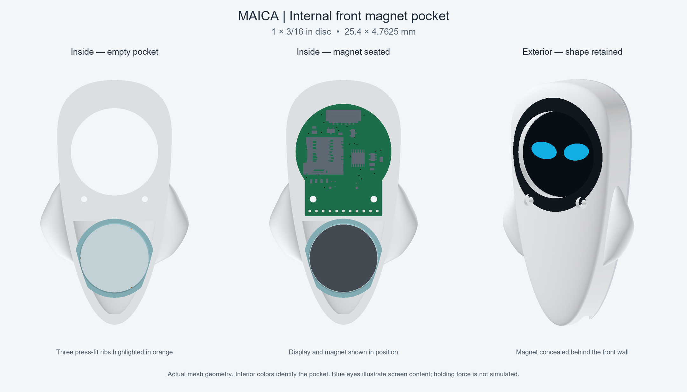

# MAICA EVE enclosure

Current enclosure for AIBOT: the **front with an internal magnet pocket**, the matching **PCBFit back**, and **two rear button caps**. The rounded shell has attached side arms, a round display opening, a bottom USB-C opening, and a press-fit front/back closure.

The assembled enclosure is approximately **55.8 x 92 x 28.8 mm**, including the arms. All model dimensions are in millimeters. This folder contains the current parts only.

## Start here

1. Print the [25p2 magnet fit ring](print/MAICA_EVE_Magnet_Fit_25p2_Print.stl) and test your actual magnet.
2. Print one each of the front, back, upper button, and lower button listed below.
3. Follow the [printing, hardware, and assembly guide](docs/ASSEMBLY.md).

The shell takes a **1-inch diameter x 3/16-inch thick N52 disc magnet** (25.4 x 4.7625 mm). The selected [totalElement 1.25-inch adhesive steel disc](https://totalelement.com/products/1-25-inch-steel-disc-with-3m-adhesive-blank-metal-strike-plates-36-pack) attaches to the computer; the magnet stays inside the shell. This is a disc-magnet/steel-plate attachment, not a MagSafe ring interface.

## Print files

The STLs are already oriented for printing. Print at 100% scale.

| Part | File | Quantity |
|---|---|---:|
| Front, with magnet pocket | [Front STL](print/MAICA_EVE_Magnet_Front_Print.stl) | 1 |
| Matching back, with PCB mounts and button guides | [Back STL](print/MAICA_EVE_PCBFit_Back_Print.stl) | 1 |
| Upper button cap | [Upper button STL](print/MAICA_EVE_PCBFit_Upper_Button_Print.stl) | 1 |
| Lower button cap | [Lower button STL](print/MAICA_EVE_PCBFit_Lower_Button_Print.stl) | 1 |
| Magnet fit ring, matching the front | [25p2 STL](print/MAICA_EVE_Magnet_Fit_25p2_Print.stl) | 1 for testing |
| Tighter diagnostic fit ring | [25p1 STL](print/MAICA_EVE_Magnet_Fit_25p1_Print.stl) | Optional |
| Looser diagnostic fit ring | [25p3 STL](print/MAICA_EVE_Magnet_Fit_25p3_Print.stl) | Optional |

The diagnostic rings do not change the supplied front. If 25p2 does not fit correctly, adjust the front's retention geometry before printing the full shell.

## CAD files

STEP models are compressed individually to keep the large CAD data manageable in Git. **Download and extract the ZIP before importing its STEP file.**

| Model | Download |
|---|---|
| Front | [Front STEP ZIP](cad/MAICA_EVE_Magnet_Front.step.zip) |
| Back | [Back STEP ZIP](cad/MAICA_EVE_PCBFit_Back.step.zip) |
| Upper button | [Upper button STEP ZIP](cad/MAICA_EVE_PCBFit_Upper_Button.step.zip) |
| Lower button | [Lower button STEP ZIP](cad/MAICA_EVE_PCBFit_Lower_Button.step.zip) |
| Complete positioned assembly, including electronics and nominal hardware | [Assembly STEP ZIP](cad/MAICA_EVE_Magnet_Onshape_Assembly.step.zip) |

Use the complete assembly to inspect the assembled product in Onshape. It contains named components and placements, including the magnet, PCB, display, and mounting hardware. The shell STEP files are faceted solids without parametric sketch/feature history. Motion mates are not included.

## Validation status

Local checks verified the front as a single watertight STL and a valid closed STEP solid, with 45 geometry checks passing. The complete STEP assembly was reimported locally and checked as 101 named leaves containing 341 valid closed solids. The back and button design is unchanged from the PCBFit revision; the assembly uses the cleaned CAD geometry prepared for STEP compatibility.

This revision has **not been physically printed or tested** for magnet fit, attachment strength, enclosure fit, or button feel. The supplied electronics model omits H1, connected wiring, and actual cable grips. Successful translation of this assembly by Onshape's cloud service has not been verified.

See the [assembly guide](docs/ASSEMBLY.md) for first-print checks, [validation notes](docs/VALIDATION.md) for the digital records, and [manifest](manifest.json) / [checksums](SHA256SUMS) for file integrity. The preview's blue eyes illustrate display content; they are not printed features or supplied firmware.

## PCB revision

These models were checked against `3D_PCB1_1_2026-11-11.step` and the revised November 11 Gerber with three mounting holes. The complete assembly includes the positioned PCB with those holes. The September 16 PCB/Gerber files elsewhere in this repository are earlier references; their fit has not been established by this model package. Compare the included assembly before using an earlier board.

## Downloading

For an individual STL or ZIP, open its link and select **Download raw file**. Extract each CAD ZIP before importing the STEP. Git LFS is not needed. The current folder includes four printable parts, three optional/test fit rings, all four individual STEP parts, and the full STEP assembly; older shell revisions are excluded.
